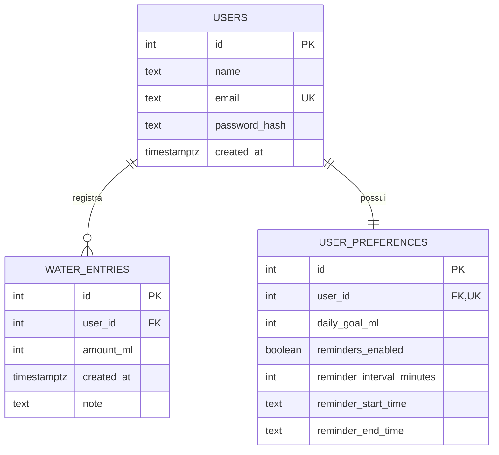

# Drink To You

> **Sua hidratação, sob controle.**

Aplicativo mobile (React Native + Expo) com API própria (Node.js + Express) para registrar o consumo de água, acompanhar a meta diária e manter uma rotina de hidratação.

Projeto da disciplina de **Linguagem de Programação VI**.

## Problema

Muitas pessoas esquecem de beber água ao longo do dia, não sabem quanto realmente consumiram, têm dificuldade de manter uma meta diária e não possuem um histórico organizado que mostre a evolução do hábito.

## Solução

O Drink To You permite:

- criar uma conta e entrar com segurança (login com JWT);
- definir uma meta diária **pessoal**;
- registrar o consumo com atalhos de 150, 250 e 500 ml ou uma quantidade personalizada;
- acompanhar o progresso do dia em um anel animado, com mensagens de incentivo e **sequência de dias** cumprindo a meta;
- ver o consumo dos **últimos 7 dias** e consultar o **histórico** agrupado por dia;
- editar e excluir registros;
- configurar **lembretes** (intervalo e horário) por notificações locais;
- consultar o **clima** da cidade (Open-Meteo) como informação de contexto;
- usar **modo escuro**.

> A meta e os valores exibidos são preferências pessoais e não constituem recomendação médica. O clima é apenas informativo e não altera a meta.

## Justificativa pessoal

> **PREENCHER PELO GRUPO:** cada integrante deve escrever, com suas palavras, por que o aplicativo seria útil no seu dia a dia ou trabalho (exigência do professor).

## Como foi feito

### Tecnologias

| Camada | Tecnologia |
|---|---|
| App | React Native, Expo (SDK 58), TypeScript |
| Navegação | React Navigation (Stack + Bottom Tabs) |
| Interface | React Native Paper, `StyleSheet` próprio, `react-native-svg` |
| Estado global | Context API (`AuthContext`, `ThemeContext`) |
| Persistência local | AsyncStorage |
| Recursos do dispositivo | `expo-notifications` (lembretes), `expo-haptics` (vibração), `expo-location` (clima) |
| API externa | [Open-Meteo](https://open-meteo.com/) |
| Backend | Node.js, Express, `express-validator`, `helmet`, `cors` |
| Segurança | `bcryptjs` (hash de senha), `jsonwebtoken` (JWT) |
| Banco de dados | PostgreSQL (Supabase) |
| Hospedagem | Render (API), EAS Build e EAS Update (app) |

### Estrutura do repositório

```
drink-to-you/
├── app/                      # Aplicativo React Native (Expo)
│   └── src/
│       ├── screens/          # auth, home, history, details, settings
│       ├── components/       # common, dashboard, water
│       ├── hooks/            # useAuth, useFetch, useWeather, useWaterSummary...
│       ├── services/         # api, auth, água, clima, notificações...
│       ├── context/          # AuthContext, ThemeContext
│       ├── navigation/       # Stack + Tabs
│       ├── theme/            # cores e layout
│       ├── types/ e utils/
├── api/                      # API Node.js + Express
│   ├── src/
│   │   ├── routes/           # definição das rotas e validações
│   │   ├── controllers/      # camada HTTP
│   │   ├── services/         # regras de negócio e acesso ao banco
│   │   ├── middlewares/      # autenticação, validação, erros
│   │   ├── database/         # conexão e schema.sql
│   │   └── config/ e utils/
│   └── scripts/seedDemo.js   # dados de demonstração
├── render.yaml               # deploy da API no Render
└── README.md
```

### Requisitos da disciplina × onde estão no código

| # | Requisito | Onde |
|---|---|---|
| 1 | Navegação Stack + Tab, tela com parâmetros | `app/src/navigation/` — `EntryDetails` recebe `{ entryId }` |
| 2 | Login com API Node.js, token guardado e enviado nos headers | `api/src/routes/authRoutes.js`, `app/src/services/api.ts` (`Authorization: Bearer`), `storage.ts` |
| 3 | Context API | `app/src/context/AuthContext.tsx`, `ThemeContext.tsx` |
| 4 | API externa com loading e erro | `app/src/services/weatherService.ts`, `components/dashboard/WeatherCard.tsx` |
| 5 | FlatList/SectionList com `keyExtractor` e detalhe | `app/src/screens/history/HistoryScreen.tsx` (SectionList) → `details/EntryDetailsScreen.tsx` |
| 6 | Formulário controlado (TextInput, Switch, Button) | `screens/settings/SettingsScreen.tsx`, `auth/LoginScreen.tsx`, `auth/RegisterScreen.tsx` |
| 7 | AsyncStorage | `app/src/services/storage.ts` (token, tema, preferências) |
| 8 | Hook customizado | `app/src/hooks/` (`useAuth`, `useFetch`, `useWeather`, `useWaterSummary`, `useSlowHint`) |
| 9 | React Native Paper + StyleSheet + layout responsivo | em todas as telas e componentes |
| 10 | Pastas screens, components, hooks, services, context | `app/src/` |
| — | Recurso de dispositivo | notificações locais, vibração (haptics) e localização |
| — | API com CRUD | `api/src/routes/waterEntryRoutes.js` |
| — | Endpoint testado no app | login, registro de água, histórico, resumo e preferências |

## DER dos dados da API



Detalhes em [DATABASE.md](DATABASE.md). O contrato dos endpoints está em [API_CONTRACT.md](API_CONTRACT.md).

## Como executar

### Pré-requisitos
Node.js 20+, npm e Git. Para testar no celular, o app **Expo Go** (ou o APK gerado).

### 1. API

```bash
cd api
npm install
cp .env.example .env     # preencha DATABASE_URL e JWT_SECRET
npm start                # http://localhost:3000
npm run seed:demo        # (opcional) cria o usuário demo com 14 dias de histórico
```

Variáveis de ambiente (`api/.env`):

| Variável | Descrição |
|---|---|
| `DATABASE_URL` | String de conexão do PostgreSQL (Supabase, *Session pooler*) |
| `JWT_SECRET` | Segredo longo e aleatório para assinar os tokens |
| `JWT_EXPIRES_IN` | Validade do token (padrão `7d`) |
| `PORT` | Porta da API (padrão `3000`) |

As tabelas são criadas automaticamente na inicialização.

### 2. App

```bash
cd app
npm install
cp .env.example .env     # EXPO_PUBLIC_API_URL=http://SEU_IP:3000/api (ou a URL pública)
npx expo start
```

Para usar a API publicada, defina `EXPO_PUBLIC_API_URL=https://drink-to-you-api.onrender.com/api`.

> No celular, **não use `localhost`**: use o IP do computador na mesma rede Wi-Fi ou a URL pública da API.

**Usuário de demonstração:** `demo@drinktoyou.com` / `demo1234`

## Segurança e boas práticas

- `.gitignore` na raiz e nas pastas impede versionar `node_modules`, `.env`, chaves, builds e bancos locais. A API traz um `.env.example` sem valores reais.
- Senhas guardadas apenas como hash (bcrypt); a senha nunca é salva no dispositivo.
- Rotas privadas exigem JWT; todas as consultas filtram pelo usuário autenticado.
- Validação no app e na API; erros em JSON consistente; tratamento de falha de rede e token expirado.
- Commits pequenos e descritivos, com *branches* por funcionalidade integradas à `main`.

## Distribuição

- **API:** Render (plano gratuito; o primeiro acesso após um tempo parado pode levar até 1 minuto).
- **Android:** APK gerado com EAS Build.
- **iPhone:** Expo Go com EAS Update.

## Equipe

Projeto desenvolvido por grupo de 3 integrantes — **PREENCHER nomes**.
