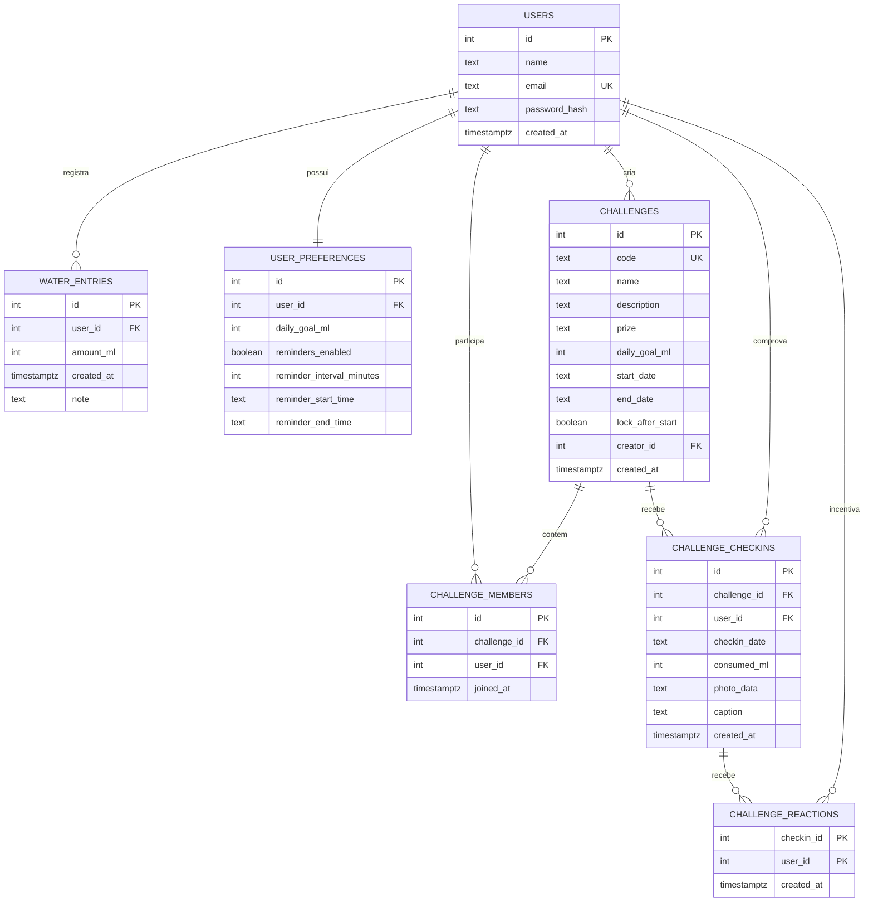

# Drink To You

> **Sua hidratação, sob controle.**

Aplicativo mobile e PWA multiplataforma (React Native + Expo + Web) com API própria (Node.js + Express + PostgreSQL) para registrar o consumo de água, acompanhar a meta diária, competir de forma amigável em **salas de desafio** e desbloquear **conquistas pessoais**.

Projeto da disciplina de **Linguagem de Programação VI**.

## Problema

Muitas pessoas esquecem de beber água ao longo do dia, não sabem quanto realmente consumiram, têm dificuldade de manter uma meta diária e perdem o interesse rapidamente em aplicativos que funcionam apenas como um despertador simples.

## Solução

O Drink To You une controle diário, gamificação pessoal e incentivo social:

- criar uma conta e entrar com segurança (login com JWT);
- definir uma meta diária **pessoal**;
- registrar o consumo com atalhos ilustrados (`150 ml Copo P`, `250 ml Copo M`, `500 ml Garrafa` ou valor personalizado) e opção de **Desfazer** imediato;
- acompanhar o progresso do dia em um anel animado com estado especial de celebração ao atingir 100% e **sequência de dias (*streak*)**;
- participar de **Salas de Desafio** (em dupla ou grupo, estilo *GymRats* + *Duolingo*) com código de convite, período definido, trava opcional após o início, ranking por pontos, **chama coletiva** e **check-in diário com foto** (anti-burla: exige meta batida + ao menos 2 registros separados + foto via câmera/galeria) e mural de incentivo (`💧 Incentivar`);
- evoluir de **Nível (XP)** e desbloquear **15 Conquistas Pessoais** distribuídas entre Bronze, Prata, Ouro e **Lendárias (Diamante)** para retenção de longo prazo;
- ver o consumo dos **últimos 7 dias** e consultar o **histórico** agrupado por dia, podendo editar e excluir registros;
- configurar **lembretes** (intervalo e janela de horário) por notificações locais;
- consultar o **clima** da cidade (Open-Meteo) como informação de contexto;
- alternar entre **modo claro e escuro**.

> A meta e os valores exibidos são preferências pessoais e não constituem recomendação médica. Eventuais premiações combinadas em salas de desafio são opcionais e de responsabilidade exclusiva dos participantes, sem intermediação do sistema.

## Justificativa pessoal

> **PREENCHER PELO GRUPO:** cada integrante deve escrever, com suas palavras, por que o aplicativo seria útil no seu dia a dia ou trabalho (exigência do professor).

## Como foi feito

### Tecnologias

| Camada | Tecnologia |
|---|---|
| App & PWA | React Native, Expo (SDK 55), React Native Web, TypeScript |
| Navegação | React Navigation (Native Stack + Bottom Tabs com 5 abas) |
| Interface | React Native Paper, `expo-linear-gradient`, `StyleSheet` próprio, `react-native-svg` |
| Estado global | Context API (`AuthContext`, `ThemeContext`) |
| Persistência local | AsyncStorage |
| Recursos do dispositivo | `expo-image-picker` (câmera/galeria nos check-ins), `expo-notifications` (lembretes), `expo-haptics` (vibração), `expo-location` (clima) |
| API externa | [Open-Meteo](https://open-meteo.com/) |
| Backend | Node.js, Express, `express-validator`, `helmet`, `cors` |
| Segurança | `bcryptjs` (hash de senha), `jsonwebtoken` (JWT) |
| Banco de dados | PostgreSQL (Supabase) |
| Hospedagem e Build | Render (API + PWA Web/iOS), EAS Build (APK Android nativo) |

### Estrutura do repositório

```
drink-to-you/
├── app/                      # Aplicativo React Native + Web PWA (Expo)
│   ├── public/               # Manifesto, ícone e fontes estáticas do PWA
│   └── src/
│       ├── screens/          # auth, home, challenges, achievements, history, details, settings
│       ├── components/       # common, dashboard, water
│       ├── hooks/            # useAuth, useFetch, useWeather, useWaterSummary, useSlowHint...
│       ├── services/         # api, auth, água, desafios, conquistas, fotos, clima, notificações...
│       ├── context/          # AuthContext, ThemeContext
│       ├── navigation/       # Stack + 5 Bottom Tabs
│       ├── theme/            # cores e layout
│       ├── types/ e utils/
├── api/                      # API Node.js + Express + Servidor Estático do PWA
│   ├── public/               # Bundle Web/PWA exportado e servido no Render
│   ├── src/
│   │   ├── routes/           # definição das rotas e validações
│   │   ├── controllers/      # camada HTTP
│   │   ├── services/         # regras de negócio, anti-burla, conquistas e banco
│   │   ├── middlewares/      # autenticação, validação, erros
│   │   ├── database/         # conexão e schema.sql
│   │   └── config/ e utils/
│   └── scripts/seedDemo.js   # dados de demonstração (14 dias + sala AGUA-DEMO)
├── render.yaml               # deploy da API + PWA no Render
└── README.md
```

### Requisitos da disciplina × onde estão no código

| # | Requisito | Onde |
|---|---|---|
| 1 | Navegação Stack + Tab, telas com parâmetros | `app/src/navigation/` — `EntryDetails` (`{ entryId }`) e `ChallengeDetails` (`{ challengeId }`) |
| 2 | Login com API Node.js, token guardado e enviado nos headers | `api/src/routes/authRoutes.js`, `app/src/services/api.ts` (`Authorization: Bearer`), `storage.ts` |
| 3 | Context API | `app/src/context/AuthContext.tsx`, `ThemeContext.tsx` |
| 4 | API externa com loading e erro | `app/src/services/weatherService.ts`, `components/dashboard/WeatherCard.tsx` |
| 5 | FlatList/SectionList com `keyExtractor` e detalhe | `screens/history/HistoryScreen.tsx` (SectionList) e `screens/challenges/ChallengesScreen.tsx` |
| 6 | Formulário controlado (TextInput, Switch, Button) | `screens/settings/SettingsScreen.tsx`, `challenges/ChallengesScreen.tsx`, `auth/LoginScreen.tsx` |
| 7 | AsyncStorage | `app/src/services/storage.ts` (token, tema, preferências, onboarding) |
| 8 | Hook customizado | `app/src/hooks/` (`useAuth`, `useFetch`, `useWeather`, `useWaterSummary`, `useSlowHint`) |
| 9 | React Native Paper + StyleSheet + layout responsivo | em todas as telas e componentes, com `KeyboardAvoidingView` |
| 10 | Pastas screens, components, hooks, services, context | `app/src/` |
| — | Recursos do dispositivo | Câmera/galeria (`expo-image-picker`), notificações (`expo-notifications`), vibração (`expo-haptics`) e localização (`expo-location`) |
| — | API com CRUD e regras de negócio | `waterEntryRoutes.js`, `challengeRoutes.js`, `achievementRoutes.js`, `preferencesRoutes.js` |

## DER dos dados da API



Detalhes em [DATABASE.md](DATABASE.md). O contrato completo dos endpoints está em [API_CONTRACT.md](API_CONTRACT.md).

## Como executar

### Pré-requisitos
Node.js 20+, npm e Git.

### 1. API

```bash
cd api
npm install
cp .env.example .env     # preencha DATABASE_URL e JWT_SECRET
npm start                # http://localhost:3000
npm run seed:demo        # (opcional) cria o usuário demo + 14 dias + sala AGUA-DEMO
```

Variáveis de ambiente (`api/.env`):

| Variável | Descrição |
|---|---|
| `DATABASE_URL` | String de conexão do PostgreSQL (Supabase, *Session pooler*) |
| `JWT_SECRET` | Segredo longo e aleatório para assinar os tokens |
| `JWT_EXPIRES_IN` | Validade do token (padrão `7d`) |
| `PORT` | Porta da API (padrão `3000`) |

### 2. App

```bash
cd app
npm install
cp .env.example .env     # EXPO_PUBLIC_API_URL=https://drink-to-you-api.onrender.com/api
npx expo start
```

**Credenciais de demonstração:**
- **Login:** `demo@drinktoyou.com` / `demo1234`
- **Código de convite de sala de desafio:** `AGUA-DEMO`

## Distribuição sem fricção (Android e iOS)

- **Android (Nativo):** instalação direta via `.apk` gerado no **EAS Build** (sem depender do Expo Go).
- **iPhone / iOS e Web (PWA):** acesse `https://drink-to-you-api.onrender.com` no Safari e toque em **Compartilhar → Adicionar à Tela de Início** para instalar o app em tela cheia como aplicativo independente, sem precisar de licença paga da App Store nem QR Code do Expo Go.

## Segurança e boas práticas

- `.gitignore` impede versionar `node_modules` de pacotes, `.env`, chaves e artefatos nativos, preservando os assets estáticos e fontes do PWA em `api/public`.
- Senhas guardadas apenas como hash (`bcryptjs`); a senha nunca é salva no dispositivo.
- Rotas privadas exigem JWT; consultas filtram dados por usuário autenticado ou participação verificada na sala.
- Validação em todas as entradas (`express-validator`); tratamento centralizado de erros e reconexão amigável.

## Equipe

Projeto desenvolvido por grupo de 3 integrantes — **PREENCHER nomes**.
